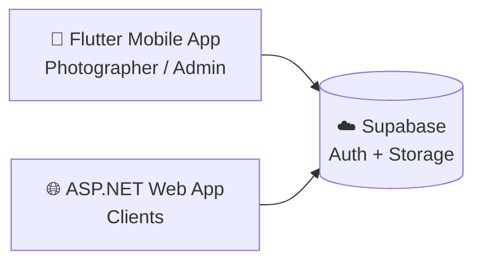
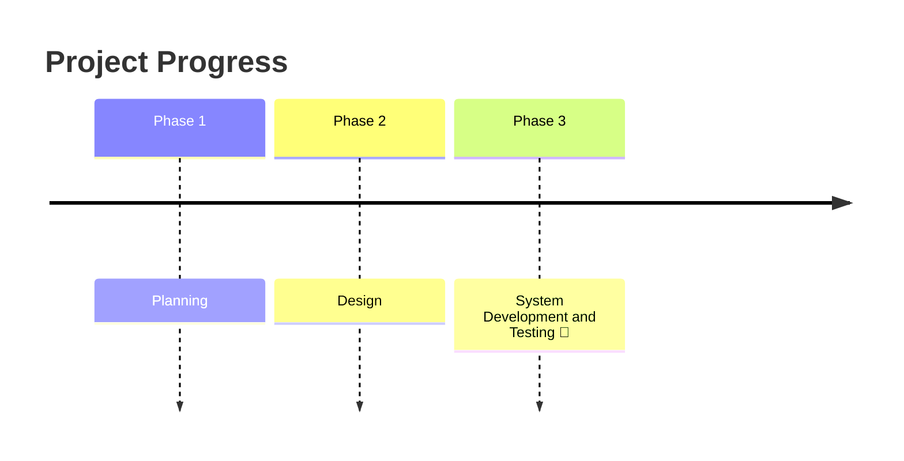

### Photography & Videography Client Management System

*The photographer's mobile app for managing client bookings and delivering content securely.*

 

---

## 📖 Table of Contents

- [Overview](#-overview)
<!--- [Screenshots](#-screenshots)-->
- [Features](#-features)
- [Tech Stack](#-tech-stack)
- [Architecture](#-architecture)
- [Project Stage](#-project-stage)
- [Stakeholder](#-stakeholder)
- [Team](#-team)

---

## 🎯 Overview

<!--This project is being developed as part of the **ITC327W Work-Integrated Learning** module at the **Central University of Technology**.-->

It is the **Photographer Website & Client Management Platform**, built for **TM Visuals** (Photography and Videography). The platform has two parts that share one backend:

| | Component | Used by | Purpose |
|---|---|---|---|
| 🌐 | **ASP.NET web app** | Clients | Book shoots, browse the portfolio, and securely access delivered photos and videos |
| 📱 | **Flutter mobile app** | TM Visuals (admin) | Manage client bookings and deliver content on the go |

It addresses real business needs around:

| | Need | What it solves |
|---|---|---|
| 📅 | **Booking** | Clients request shoots online and the photographer manages them from their phone |
| 🖼️ | **Portfolio visibility** | Showcases TM Visuals' work to prospective clients |
| 🔒 | **Secure content delivery** | The photographer uploads finished content and each client accesses only their own |

> [!NOTE]
> This repository contains **both** the ASP.NET website and the Flutter mobile app. Both connect to the same **Supabase** backend for authentication and storage.

<!--## 📸 Screenshots

 Replace with real screenshots. Side-by-side layout: 

  
  
  

-->
---

## ✨ Features

- 🔐 **Secure admin login** powered by Supabase Auth
- 📅 **Booking management** to review and manage client bookings
- 👥 **Client management** with client details and shoot history
- 📤 **Content delivery** by uploading photos and videos to Supabase Storage for specific clients

---

## 🛠️ Tech Stack

| Layer | Technology | Purpose |
|---|---|---|
| 📱 Mobile app | **Flutter** | Admin app for the photographer |
| 🌐 Web app | **ASP.NET** | Client-facing website: booking, portfolio, content access |
| 🔑 Auth & Storage | **Supabase** | Authentication and secure file storage |

---

## 🧩 Architecture

---

## 🚧 Project Stage

> [!IMPORTANT]
> Currently in **Phase 3, System Development and Testing**. 

---

## 🤝 Stakeholder

**TM Visuals**, a photography and film business based in Johannesburg, represented by **Tshedza Mulaudzi**.

---

## 👥 Team

| Name |
|---|
| S Lukhele |
| M Bonga |
| S Mbasa |
| Z Mvimbi |
| K Matsane |
| KTJ Phatsoane |
| MF Mulaudzi |
| B Lombaard |

</a>

---

Built with 💙 for **TM Visuals** · Central University of Technology 

